# 📱 Mobile Games

iOS ve Android için geliştirdiğim iki mobil oyun: **Tilterix** ve **Liney Family**.

| Oyun | Tür | Platform |
|---|---|---|
| [Tilterix](#-tilterix) | Fizik / denge tabanlı blok bulmaca | iOS · Android |
| [Liney Family](#-liney-family) | Çok şeritli sonsuz koşu (endless runner) | iOS · Android |

---

## 🌾 Tilterix

Klasik blok yerleştirme oyununa **denge mekaniği** ekleyen bir bulmaca oyunu. Mahsul kasaları bir tahterevallinin üzerine düşer. Kasaları kenara yığdıkça tahterevalli o tarafa yatar. Oyuncu hem satır tamamlamaya hem de platformu dengede tutmaya çalışır, yoksa tahterevalli devrilir.

  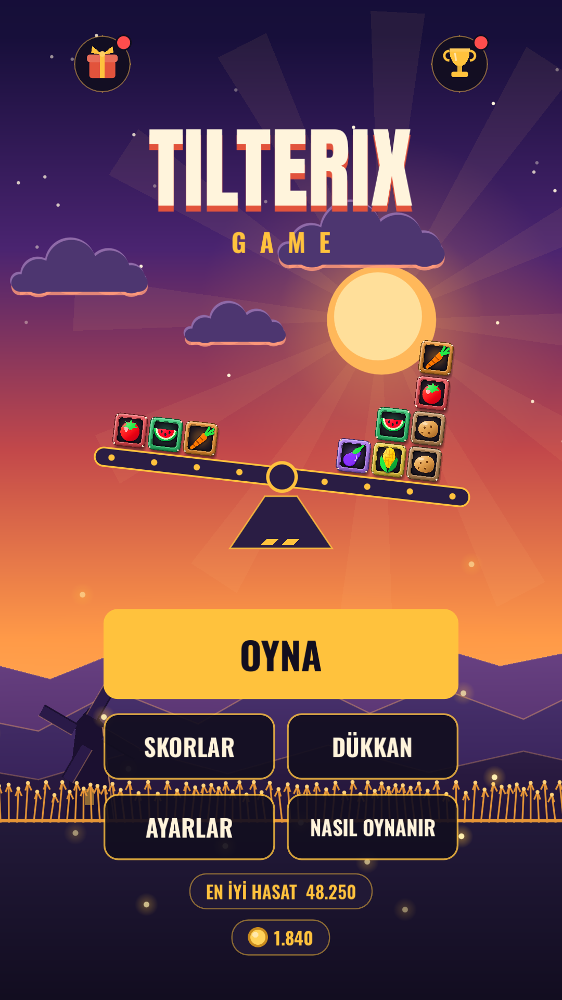
  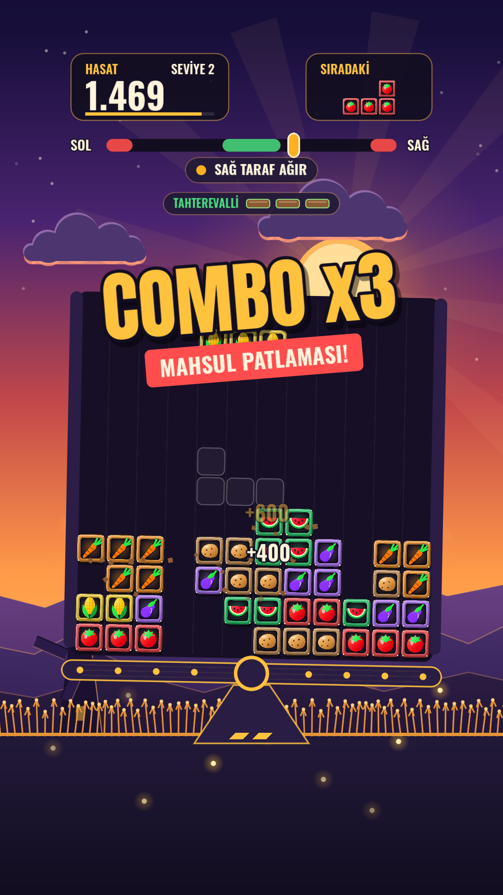
  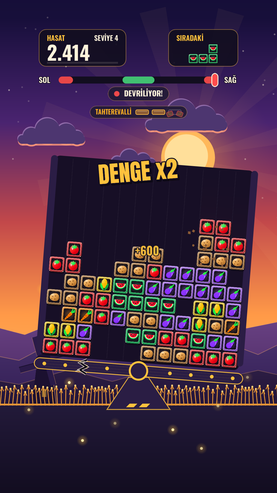

### Öne çıkan özellikler
- **Denge sistemi:** Ağırlık dağılımı anlık olarak hesaplanır ve göstergede (Sol ↔ Sağ) gösterilir. Tahterevalli dengedeyken silinen satırlar ×2 puan verir.
- **Combo ve “Mahsul Patlaması”:** Art arda satır silmek çarpanları artırır (Combo x3, Denge x2…).
- **Devrilme mekaniği:** Denge bozulunca platform yatar ve oyuncuya ek bir risk / ödül katmanı sunar.
- **Seviye sistemi** ve “Sıradaki” blok önizlemesi.
- **Dükkan:** Altınla açılan tahterevalli çeşitleri (Çam, Meşe, Ceviz, Demir Kaplı); her birinin can ve onarım değerleri farklı. Ayrıca tema, kasa ve güç kategorileri var.
- **Ödüller:** Süreli günlük görevler, başarımlar ve rekor tablosu.
- **Etkileşimli öğretici:** Adım adım “Nasıl Oynanır” ekranı.

  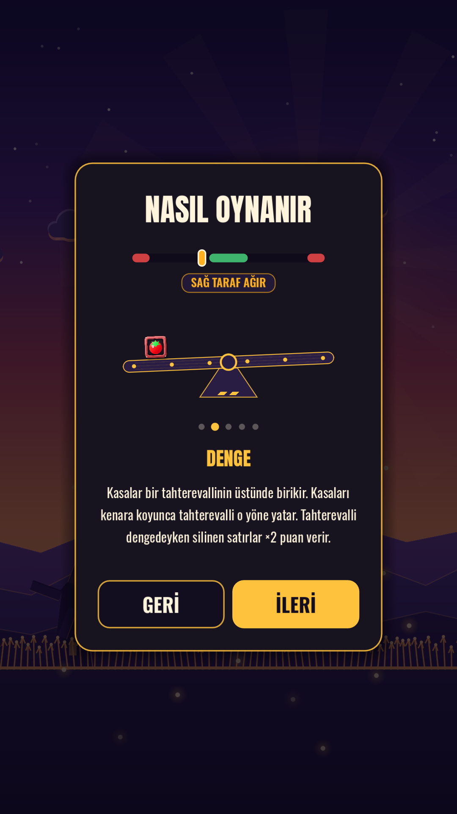
  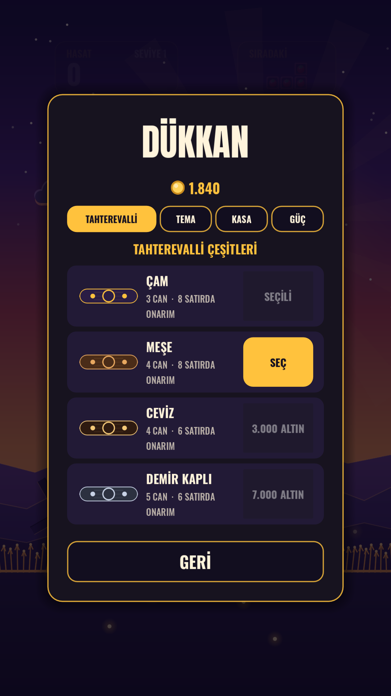
  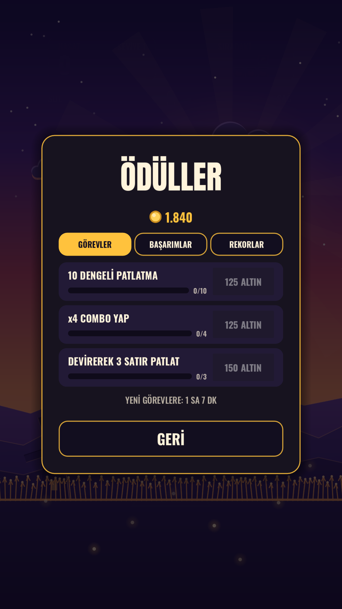

---

## ✏️ Liney Family

Defter sayfasında geçen, el çizimi görünümlü bir **sonsuz koşu** oyunu. Her çizgi ayrı bir şerit ve her şeritte ailenin farklı bir üyesi koşuyor. Oyuncu aynı anda birden fazla karakteri kontrol ederek silgilerden kaçar. Elenen karaktere “Silindin!” denir.

  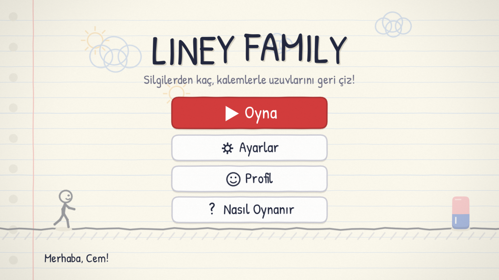
  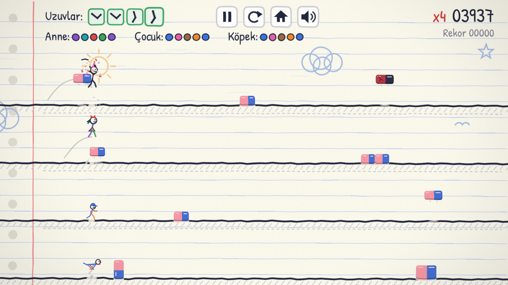

### Öne çıkan özellikler
- **Çoklu karakter kontrolü:** 1 ile 4 arasında karakter (anne, baba, çocuk, köpek) aynı anda ayrı şeritlerde koşar; zorluk karakter sayısıyla artar.
- **4 oyun modu:** Bekâr, Evli, Evli çocuklu ve Tüm aile. Her modun kendi rekoru var.
- **Kozmetik sistemi:** Oynadıkça açılan süsler (gözlük, parti şapkası, bandana, kask, taç…).
- **Detaylı skor ekranı:** Mesafe, seri, aile ve sayfa gibi puan kırılımları, en uzun seri, çarpan, yeni rozetler ve rekorlar.
- **Çarpan ve seri sistemi** ile oyun içi anlık skor takibi.
- Defter kâğıdı, kurşun kalem çizgileri ve el yazısı fontlarla **özgün görsel stil**.

  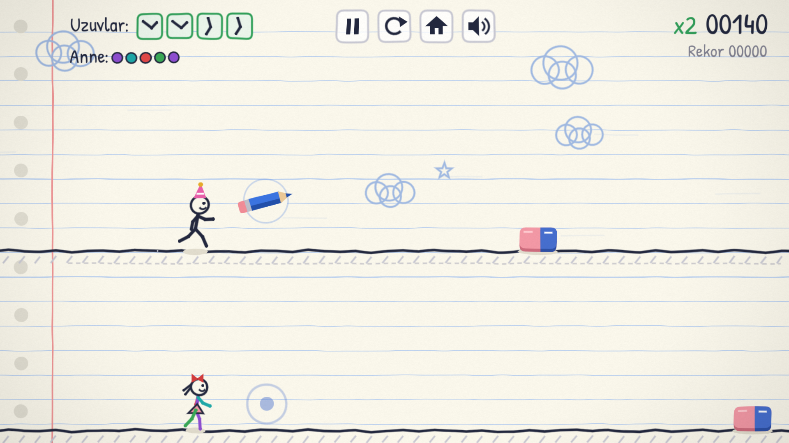
  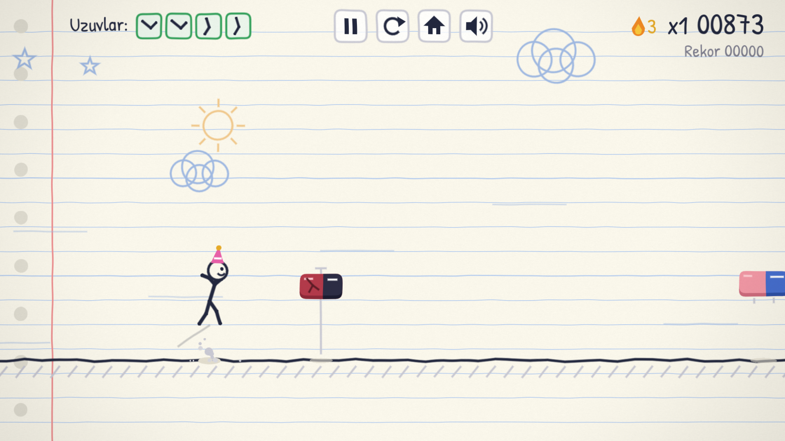

  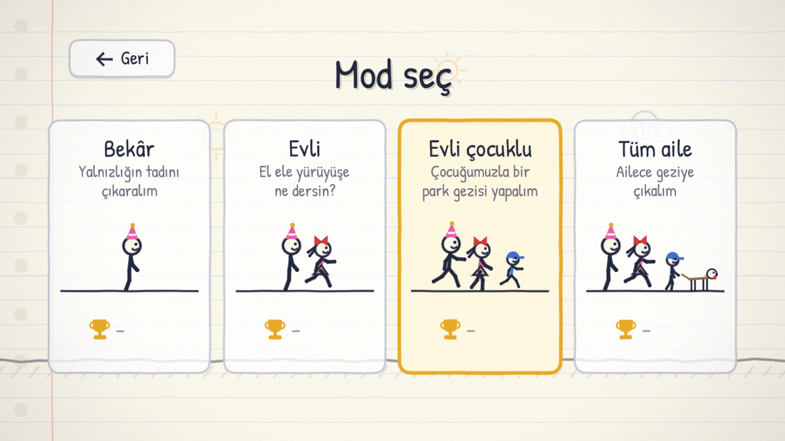
  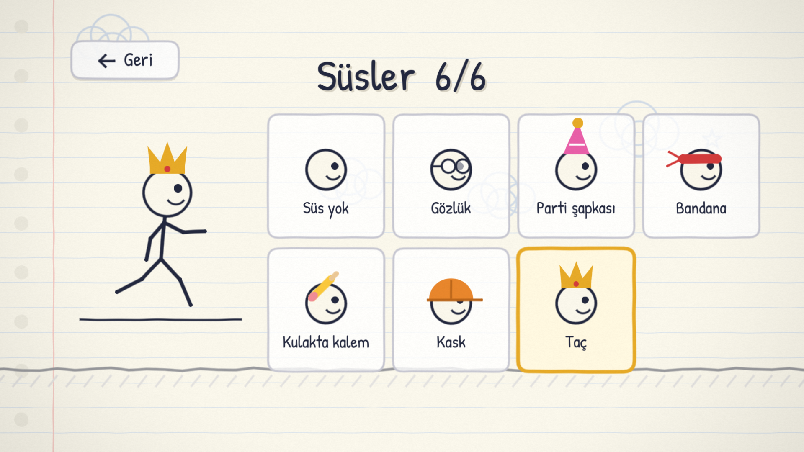

  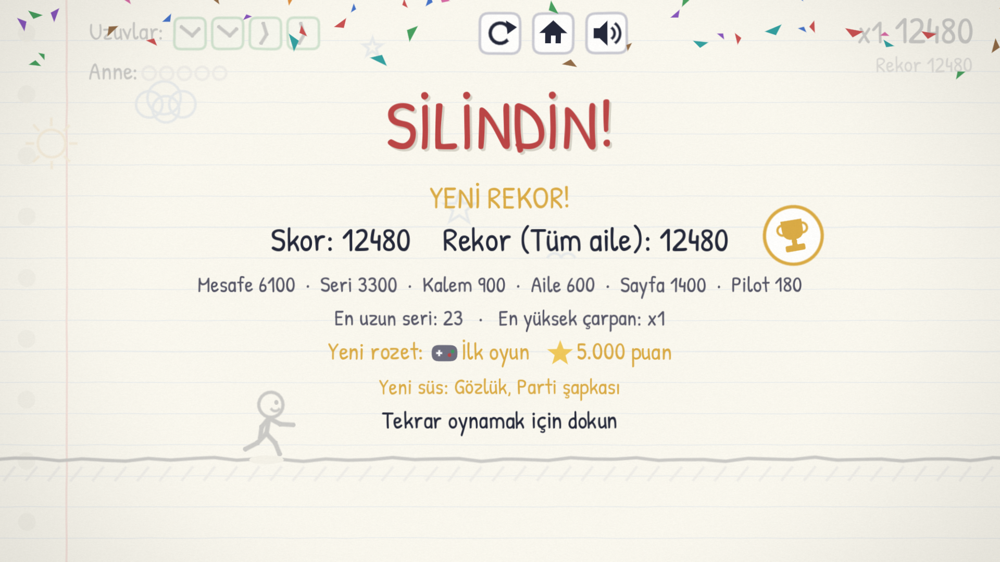

---

## 👤 Geliştirici

**Cem Söylemezoğlu** · [GitHub](https://github.com/cemsoylemezoglu)
